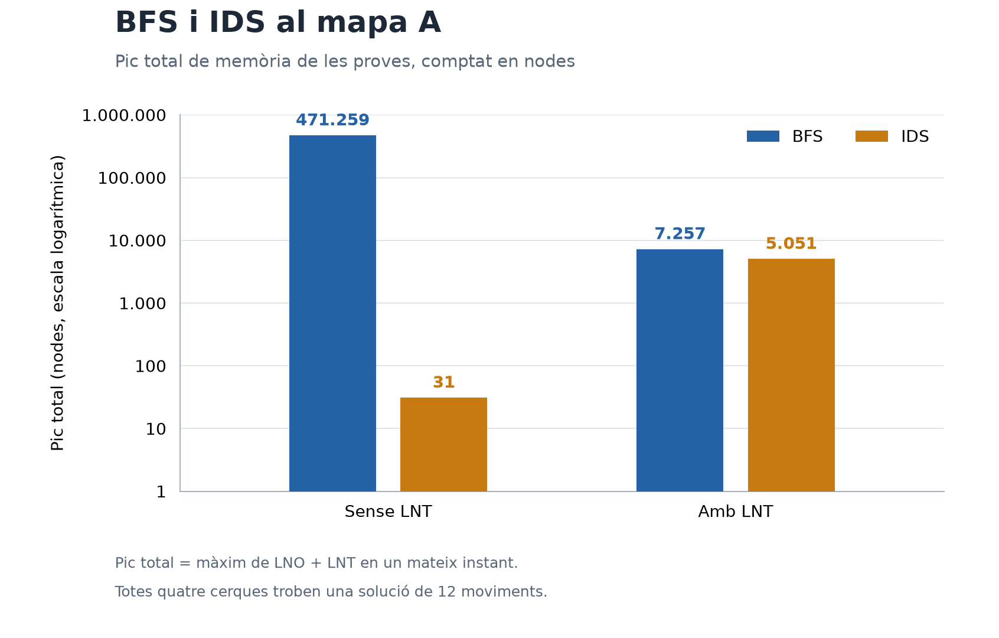

# Estudi de Multi-Snake

## Pla PDDL

Pla retornat per LAMA-first per al mapa A. **Longitud: 12 accions.**

```text
(moure agent-a p26 p25)
(moure agent-a p25 p24)
(moure agent-a p24 p23)
(moure agent-b p41 p42)
(moure agent-b p42 p43)
(moure agent-b p43 p44)
(moure agent-a p23 p22)
(moure agent-a p22 p21)
(sortir agent-a p21 p20)
(moure agent-b p44 p45)
(moure agent-b p45 p46)
(sortir agent-b p46 p47)
```

## Condicions de les proves

Les proves s’han fet en un **Apple M4 Pro de 14 nuclis, amb 24 GiB de RAM i macOS 26.6.2**. Totes les cerques s’han executat amb **`-Xmx2g` i un límit de 120 segons**, seqüencialment.

A les taules, **M** indica esgotament de memòria i **T**, límit de temps. **†** identifica l’última mostra recuperada abans del tall: els comptadors, els pics i el temps de cerca són parcials i es mostren amb `≥`. Un zero en una mostra inicial no implica que la cerca no hagi explorat nodes. El tall per temps es fa als 120 segons de procés; el temps parcial de cerca pot ser inferior. La memòria es mesura en nodes.

## Respostes de l’estudi

### [1] Resum dels mapes i algorismes

S’han executat les 70 combinacions de mapa, cerca i ús de LNT. S’han obtingut **27 plans vàlids**, **33 fallades per memòria** i **10 per temps**. Un nombre al resum indica la longitud de la solució.

| Cerca | LNT | A | B1 | B2 | C | D | E | F |
|---|---|---:|---:|---:|---:|---:|---:|---:|
| BFS | No | 12 | M | M | M | M | M | M |
| BFS | Sí | 12 | M | M | M | M | M | M |
| DFS | No | 12 | 19 | 31 | T | T | T | T |
| DFS | Sí | 12 | 19 | 31 | M | M | M | M |
| IDS | No | 12 | T | T | T | T | T | T |
| IDS | Sí | 12 | M | M | M | M | M | M |
| A* bàsica | No | 12 | 17 | 19 | 112 | M | M | M |
| A* bàsica | Sí | 12 | 17 | 19 | 112 | M | M | M |
| A* avançada | No | 12 | 17 | 19 | 112 | M | M | M |
| A* avançada | Sí | 12 | 17 | 19 | 112 | 42 | M | M |

Els òptims de referència de l’enunciat són A=12 i D=42. Les cerques que garanteixen l’òptim i han acabat estableixen també B1=17, B2=19 i C=112. A les taules, una solució de DFS es marca com a òptima només si coincideix amb aquests costos, sense atribuir a DFS una garantia general.

#### Mètriques del mapa A

| Cerca | LNT | Resultat | Longitud | Òptima | Explorats | Tallats | Pic LNO | Pic LNT | Pic total | Temps cerca (ms) |
|---|---|---|---:|---|---:|---:|---:|---:|---:|---:|
| BFS | No | Sí | 12 | Sí | 697815 | 0 | 471259 | 0 | 471259 | 419 |
| BFS | Sí | Sí | 12 | Sí | 5893 | 5377 | 2355 | 5892 | 7257 | 23 |
| DFS | No | Sí | 12 | Sí | 13 | 0 | 23 | 0 | 23 | 5 |
| DFS | Sí | Sí | 12 | Sí | 13 | 0 | 23 | 12 | 35 | 5 |
| IDS | No | Sí | 12 | Sí | 993967 | 992008 | 31 | 0 | 31 | 423 |
| IDS | Sí | Sí | 12 | Sí | 15770 | 25063 | 29 | 5051 | 5051 | 35 |
| A* bàsica | No | Sí | 12 | Sí | 13 | 0 | 23 | 0 | 23 | 9 |
| A* bàsica | Sí | Sí | 12 | Sí | 13 | 0 | 23 | 12 | 35 | 8 |
| A* avançada | No | Sí | 12 | Sí | 13 | 3 | 20 | 0 | 20 | 8 |
| A* avançada | Sí | Sí | 12 | Sí | 13 | 3 | 20 | 12 | 32 | 8 |

#### Mètriques del mapa B1

| Cerca | LNT | Resultat | Longitud | Òptima | Explorats | Tallats | Pic LNO | Pic LNT | Pic total | Temps cerca (ms) |
|---|---|---|---:|---|---:|---:|---:|---:|---:|---:|
| BFS | No | No (M) † | — | — | ≥ 877665 | ≥ 0 | ≥ 2631677 | ≥ 0 | ≥ 2631677 | ≥ 2088 |
| BFS | Sí | No (M) † | — | — | ≥ 1227030 | ≥ 1171055 | ≥ 2166720 | ≥ 1227029 | ≥ 3393749 | ≥ 5294 |
| DFS | No | Sí | 19 | No | 129 | 0 | 67 | 0 | 67 | 7 |
| DFS | Sí | Sí | 19 | No | 129 | 0 | 67 | 128 | 189 | 9 |
| IDS | No | No (T) † | — | — | ≥ 145484737 | ≥ 377043190 | ≥ 66 | ≥ 0 | ≥ 66 | ≥ 119008 |
| IDS | Sí | No (M) † | — | — | ≥ 8739247 | ≥ 22897607 | ≥ 80 | ≥ 3507153 | ≥ 3507173 | ≥ 36058 |
| A* bàsica | No | Sí | 17 | Sí | 28 | 0 | 66 | 0 | 66 | 8 |
| A* bàsica | Sí | Sí | 17 | Sí | 28 | 0 | 66 | 27 | 93 | 8 |
| A* avançada | No | Sí | 17 | Sí | 18 | 4 | 56 | 0 | 56 | 10 |
| A* avançada | Sí | Sí | 17 | Sí | 18 | 4 | 56 | 17 | 73 | 9 |

#### Mètriques del mapa B2

| Cerca | LNT | Resultat | Longitud | Òptima | Explorats | Tallats | Pic LNO | Pic LNT | Pic total | Temps cerca (ms) |
|---|---|---|---:|---|---:|---:|---:|---:|---:|---:|
| BFS | No | No (M) † | — | — | ≥ 839237 | ≥ 0 | ≥ 2670271 | ≥ 0 | ≥ 2670271 | ≥ 2140 |
| BFS | Sí | No (M) † | — | — | ≥ 1162285 | ≥ 1075522 | ≥ 2236323 | ≥ 1162284 | ≥ 3398607 | ≥ 6060 |
| DFS | No | Sí | 31 | No | 24930927 | 0 | 95 | 0 | 95 | 7387 |
| DFS | Sí | Sí | 31 | No | 8050 | 7115 | 95 | 8049 | 8126 | 28 |
| IDS | No | No (T) † | — | — | ≥ 110738981 | ≥ 315726894 | ≥ 58 | ≥ 0 | ≥ 58 | ≥ 119008 |
| IDS | Sí | No (M) † | — | — | ≥ 8432549 | ≥ 22911991 | ≥ 71 | ≥ 3494955 | ≥ 3494975 | ≥ 41111 |
| A* bàsica | No | Sí | 19 | Sí | 648328 | 0 | 1061058 | 0 | 1061058 | 797 |
| A* bàsica | Sí | Sí | 19 | Sí | 4767 | 4012 | 9090 | 4766 | 13856 | 35 |
| A* avançada | No | Sí | 19 | Sí | 1453 | 962 | 5316 | 0 | 5316 | 46 |
| A* avançada | Sí | Sí | 19 | Sí | 227 | 256 | 765 | 226 | 991 | 22 |

#### Mètriques del mapa C

| Cerca | LNT | Resultat | Longitud | Òptima | Explorats | Tallats | Pic LNO | Pic LNT | Pic total | Temps cerca (ms) |
|---|---|---|---:|---|---:|---:|---:|---:|---:|---:|
| BFS | No | No (M) † | — | — | ≥ 0 | ≥ 0 | ≥ 0 | ≥ 0 | ≥ 0 | ≥ 0 |
| BFS | Sí | No (M) † | — | — | ≥ 31872 | ≥ 39231 | ≥ 219802 | ≥ 31871 | ≥ 251673 | ≥ 1146 |
| DFS | No | No (T) † | — | — | ≥ 18545443 | ≥ 136635835 | ≥ 500 | ≥ 0 | ≥ 500 | ≥ 119018 |
| DFS | Sí | No (M) † | — | — | ≥ 252024 | ≥ 1953007 | ≥ 500 | ≥ 252023 | ≥ 252496 | ≥ 10047 |
| IDS | No | No (T) † | — | — | ≥ 21203047 | ≥ 157702686 | ≥ 82 | ≥ 0 | ≥ 82 | ≥ 119018 |
| IDS | Sí | No (M) † | — | — | ≥ 486124 | ≥ 3811059 | ≥ 82 | ≥ 252651 | ≥ 252664 | ≥ 13096 |
| A* bàsica | No | Sí | 112 | Sí | 113 | 0 | 547 | 0 | 547 | 12 |
| A* bàsica | Sí | Sí | 112 | Sí | 113 | 0 | 547 | 112 | 659 | 14 |
| A* avançada | No | Sí | 112 | Sí | 113 | 6 | 541 | 0 | 541 | 115 |
| A* avançada | Sí | Sí | 112 | Sí | 113 | 6 | 541 | 112 | 653 | 105 |

#### Mètriques del mapa D

| Cerca | LNT | Resultat | Longitud | Òptima | Explorats | Tallats | Pic LNO | Pic LNT | Pic total | Temps cerca (ms) |
|---|---|---|---:|---|---:|---:|---:|---:|---:|---:|
| BFS | No | No (M) † | — | — | ≥ 479738 | ≥ 0 | ≥ 1591293 | ≥ 0 | ≥ 1591293 | ≥ 1036 |
| BFS | Sí | No (M) † | — | — | ≥ 636685 | ≥ 569179 | ≥ 1411466 | ≥ 636684 | ≥ 2048150 | ≥ 3016 |
| DFS | No | No (T) † | — | — | ≥ 109693154 | ≥ 222725745 | ≥ 172 | ≥ 0 | ≥ 172 | ≥ 119009 |
| DFS | Sí | No (M) † | — | — | ≥ 2082148 | ≥ 4433018 | ≥ 174 | ≥ 2082147 | ≥ 2082306 | ≥ 24131 |
| IDS | No | No (T) † | — | — | ≥ 109416735 | ≥ 330300738 | ≥ 55 | ≥ 0 | ≥ 55 | ≥ 119009 |
| IDS | Sí | No (M) † | — | — | ≥ 4645950 | ≥ 13992958 | ≥ 64 | ≥ 2094157 | ≥ 2094186 | ≥ 20114 |
| A* bàsica | No | No (M) † | — | — | ≥ 741136 | ≥ 0 | ≥ 1334957 | ≥ 0 | ≥ 1334957 | ≥ 2141 |
| A* bàsica | Sí | No (M) † | — | — | ≥ 685575 | ≥ 495781 | ≥ 1343533 | ≥ 685574 | ≥ 2029107 | ≥ 4036 |
| A* avançada | No | No (M) † | — | — | ≥ 775386 | ≥ 818391 | ≥ 1295905 | ≥ 0 | ≥ 1295905 | ≥ 34110 |
| A* avançada | Sí | Sí | 42 | Sí | 50011 | 99974 | 72482 | 50010 | 122492 | 868 |

#### Mètriques del mapa E

| Cerca | LNT | Resultat | Longitud | Òptima | Explorats | Tallats | Pic LNO | Pic LNT | Pic total | Temps cerca (ms) |
|---|---|---|---:|---|---:|---:|---:|---:|---:|---:|
| BFS | No | No (M) † | — | — | ≥ 0 | ≥ 0 | ≥ 0 | ≥ 0 | ≥ 0 | ≥ 0 |
| BFS | Sí | No (M) † | — | — | ≥ 68943 | ≥ 92116 | ≥ 392888 | ≥ 68943 | ≥ 461831 | ≥ 1010 |
| DFS | No | No (T) † | — | — | ≥ 21352111 | ≥ 144440393 | ≥ 406 | ≥ 0 | ≥ 406 | ≥ 119009 |
| DFS | Sí | No (M) † | — | — | ≥ 465226 | ≥ 3258121 | ≥ 407 | ≥ 465225 | ≥ 465577 | ≥ 8014 |
| IDS | No | No (T) † | — | — | ≥ 31732636 | ≥ 214574478 | ≥ 71 | ≥ 0 | ≥ 71 | ≥ 119009 |
| IDS | Sí | No (M) † | — | — | ≥ 808574 | ≥ 5576961 | ≥ 80 | ≥ 465953 | ≥ 465994 | ≥ 10048 |
| A* bàsica | No | No (M) † | — | — | ≥ 0 | ≥ 0 | ≥ 0 | ≥ 0 | ≥ 0 | ≥ 0 |
| A* bàsica | Sí | No (M) † | — | — | ≥ 116925 | ≥ 113625 | ≥ 340551 | ≥ 116924 | ≥ 457475 | ≥ 1010 |
| A* avançada | No | No (M) † | — | — | ≥ 138882 | ≥ 292026 | ≥ 325484 | ≥ 0 | ≥ 325484 | ≥ 63036 |
| A* avançada | Sí | No (M) † | — | — | ≥ 123432 | ≥ 284256 | ≥ 339504 | ≥ 123431 | ≥ 462935 | ≥ 58154 |

#### Mètriques del mapa F

| Cerca | LNT | Resultat | Longitud | Òptima | Explorats | Tallats | Pic LNO | Pic LNT | Pic total | Temps cerca (ms) |
|---|---|---|---:|---|---:|---:|---:|---:|---:|---:|
| BFS | No | No (M) † | — | — | ≥ 143098 | ≥ 0 | ≥ 905925 | ≥ 0 | ≥ 905925 | ≥ 1067 |
| BFS | Sí | No (M) † | — | — | ≥ 180728 | ≥ 271567 | ≥ 863876 | ≥ 180727 | ≥ 1044603 | ≥ 2156 |
| DFS | No | No (T) † | — | — | ≥ 52865330 | ≥ 221949575 | ≥ 427 | ≥ 0 | ≥ 427 | ≥ 119005 |
| DFS | Sí | No (M) † | — | — | ≥ 1053785 | ≥ 4456863 | ≥ 427 | ≥ 1053784 | ≥ 1054162 | ≥ 9027 |
| IDS | No | No (T) † | — | — | ≥ 51732327 | ≥ 294658556 | ≥ 92 | ≥ 0 | ≥ 92 | ≥ 119010 |
| IDS | Sí | No (M) † | — | — | ≥ 1935077 | ≥ 11939790 | ≥ 102 | ≥ 1054192 | ≥ 1054228 | ≥ 15029 |
| A* bàsica | No | No (M) † | — | — | ≥ 292876 | ≥ 0 | ≥ 751555 | ≥ 0 | ≥ 751555 | ≥ 1095 |
| A* bàsica | Sí | No (M) † | — | — | ≥ 244588 | ≥ 240498 | ≥ 738568 | ≥ 244587 | ≥ 983155 | ≥ 2050 |
| A* avançada | No | No (M) † | — | — | ≥ 210892 | ≥ 230565 | ≥ 833864 | ≥ 0 | ≥ 833864 | ≥ 66082 |
| A* avançada | Sí | No (M) † | — | — | ≥ 207836 | ≥ 470230 | ≥ 829792 | ≥ 207835 | ≥ 1037627 | ≥ 68028 |

Els errors de temps o memòria indiquen que no s’ha trobat una solució dins dels recursos permesos; no demostren que el mapa sigui irresoluble. En IDS, les exploracions i els talls acumulen totes les iteracions, mentre que els pics de memòria són màxims, no sumes.

### [2] Té sentit buscar cicles dins de la branca?

En Multi-Snake no pot aparèixer el mateix estat complet dues vegades en una branca: cada moviment converteix una casella que encara no era paret en paret permanent. El nombre de parets creix estrictament, i la igualtat inclou tota la graella. Per tant, no hi ha cicles d’estat, encara que un agent intenti tornar geomètricament cap a una posició anterior: el rastre ho impedeix.

El control d’ancestres és redundant per a aquest model, però es manté perquè el demana l’enunciat. Ho confirma BFS sense LNT a A: **0 talls**. En canvi, BFS amb LNT talla **5.377** repeticions: són arribades des de branques diferents, principalment intercalacions equivalents de moviments d’agents diferents.

Els talls d’IDS sense LNT no contradiuen aquesta propietat: inclouen els successors descartats pel límit de profunditat de cada iteració. Els d’A* avançada també inclouen la poda de sortides inabastables.

### [3] Factor d’embrancament real de BFS a A i avantatges de LNT

E és el nombre de nodes explorats, inclosa la meta; G és el nombre de successors legals generats abans de la poda. La mitjana real de successors de la part expandida de l’arbre és **G/(E−1)**: es descompta la meta perquè no s’expandeix.

| LNT | Explorats (E) | Generats (G) | G/(E−1) | Pic total |
|---|---:|---:|---:|---:|
| No | 697815 | 1168963 | 1.675178 | 471259 |
| Sí | 5893 | 12607 | 2.139681 | 7257 |

Les dues cerques expandeixen conjunts i multiplicitats d’estats diferents. Una mitjana de successors més alta no significa que la LNT empitjori la cerca: el benefici s’observa en les exploracions i en la memòria totals.

Amb LNT s’exploren **5.893** nodes, en lloc de **697.815**: aproximadament **118,4 vegades menys**. El pic total baixa de **471.259** a **7.257** nodes, unes **64,9 vegades menys**, malgrat emmagatzemar també els tancats. La LNT costa memòria per entrada i consultes de hash, però evita tornar a expandir molts estats equivalents i redueix molt més la frontera en aquest mapa.

### [4] Diferències entre B1 i B2

Tots dos mapes tenen 7×10 caselles, 42 transitables i dos agents; canvia la configuració dels agents/sortides i, per tant, la compatibilitat dels camins. La mida del rectangle per si sola no prediu la dificultat.

A* estableix un òptim de **17 moviments en B1** i **19 en B2**. DFS retorna **19** i **31**, respectivament: són plans vàlids, però subòptims. En B2, DFS passa de **24.930.927** exploracions sense LNT a **8.050** amb LNT. Això mostra la quantitat de branques equivalents que pot recórrer abans de trobar el primer pla.

BFS esgota el heap als dos mapes, amb i sense LNT. IDS sense LNT arriba al límit de temps i amb LNT esgota memòria. A* bàsica sense LNT explora **28** nodes a B1 i **648.328** a B2; l’avançada amb LNT en necessita **18** i **227**. La posició dels agents i els colls d’ampolla fan que B2 exigeixi descartar més camins incompatibles, tot i tenir una longitud òptima només dos moviments superior.

### [5] Admissibilitat, consistència i A* amb LNT

Siguin `g(s)` el cost ja recorregut i `h*(s)` el cost mínim restant. Una heurística és admissible si `h(s) ≤ h*(s)` i consistent si, per qualsevol moviment de cost 1, `h(s) ≤ 1+h(s')`, amb valor zero a la meta.

**Bàsica.** Cada agent necessita almenys la seva distància Manhattan per arribar a la sortida, i un torn només mou un agent una casella. La suma és una cota inferior, encara que hi hagi obstacles o interferències: és admissible. Un moviment només pot reduir en una unitat la distància Manhattan de l’agent que es mou; la resta de termes no canvien. Quan surt, la contribució passa d’1 a 0. Per tant, és consistent.

**Avançada.** La BFS individual troba una distància mínima al tauler actual. Qualsevol solució global haurà de donar a cada agent un camí d’almenys aquella longitud; altres moviments només poden afegir obstacles. La suma és admissible, encara que els camins individuals mínims siguin incompatibles entre si. Si una sortida és inabastable ara, els moviments futurs no poden obrir un pas: la poda és segura.

Per a la consistència, considerem l’agent que es mou de `p` a `q`: qualsevol camí restant des de `q` es pot precedir amb el pas `p→q`, de manera que la seva distància anterior és com a màxim 1 més la nova. Per als altres agents, la casella `p` ja estava bloquejada per l’agent i passa a ser paret; `q` passa de lliure a bloquejada. No guanyen cap casella i les seves distàncies no disminueixen. Si l’agent surt, la seva distància anterior era 1 i la nova contribució és 0. Sumant, s’obté la desigualtat de consistència. Els estats `INF` no poden recuperar una solució.

Amb una heurística consistent, A* pot tancar un estat quan l’extreu amb cost mínim i no necessita reobrir-lo per conservar l’òptim. La implementació igualment admet un `g` menor com a protecció general per a altres heurístiques admissibles que fossin inconsistents. La garantia depèn d’extreure la meta de la cua, i no d’acabar quan es genera per primer cop.

### [6] Quina heurística dona millors resultats?

L’avançada domina la bàsica com a estimació: una distància que respecta obstacles no pot ser menor que Manhattan. A més, detecta estats impossibles que la bàsica continua explorant. A B1, A* passa de **28** exploracions amb la bàsica a **18** amb l’avançada. A B2 sense LNT passa de **648.328** a **1.453**; amb LNT, de **4.767** a **227**.

A A, totes dues exploren 13 nodes pel desempat que afavoreix menor `h`, però l’avançada talla tres successors i redueix el pic total de 23 a 20 sense LNT, i de 35 a 32 amb LNT. No s’ha de concloure que sempre serà més ràpida: calcula una BFS per agent i estat, mentre que Manhattan és molt barata. Cal valorar conjuntament temps, expansions, memòria i finalització, com mostren les taules de C i D.

### [7] Influència de les heurístiques al mapa C

C té 25×78 caselles, 1.751 transitables i tres agents. Les quatre variants d’A* troben plans vàlids i òptims de **112 moviments** explorant **113 nodes**. Amb el desempat per menor `h`, totes dues heurístiques segueixen una branca de cost òptim; no cal esperar necessàriament un gran avantatge de l’avançada en aquest mapa.

La bàsica triga **12 ms sense LNT** i **14 ms amb LNT**; l’avançada, **115 ms** i **105 ms**. L’avançada talla sis successors i redueix modestament els pics totals (547→541 sense LNT; 659→653 amb LNT), però el cost de les BFS individuals sobre una graella gran domina el temps. Això és un exemple mesurat de més informació heurística sense menys expansions, i amb més cost per node.

BFS esgota memòria en ambdues variants; DFS i IDS sense LNT arriben als 120 segons, i amb LNT esgoten el heap. La profunditat òptima 112 també queda fora de l’abast de la DFS limitada a 50. Les dades s’ajusten aquí a l’observació de l’enunciat que C requereix una cerca informada sota els límits de l’experiment.

### [8] Influència de les heurístiques al mapa D


D té 10×16 caselles, 104 transitables i dos agents. Només **A* avançada amb LNT** acaba sota els límits de la bateria: troba un pla validat de **42 moviments**, que coincideix amb l’òptim de referència de l’enunciat. Explora **50.011** nodes, talla **99.974** i arriba a un pic total de **122.492** nodes en **868 ms** de cerca.

A* bàsica esgota el heap amb i sense LNT: les darreres mostres ja registren almenys **741.136** i **685.575** exploracions. A* avançada sense LNT també esgota memòria, després d’almenys **775.386** exploracions i **818.391** talls observats. Respecte de les 50.011 exploracions del cas resolt, és més de 15 vegades el treball abans de fallar. Els obstacles fan que Manhattan sigui poc informativa i que la poda d’inabastables sigui especialment útil; alhora, les repeticions entre branques fan necessària la LNT en aquesta execució.

BFS falla per memòria en totes dues variants; DFS i IDS sense LNT fallen per temps i amb LNT per memòria. La conclusió no és només que D necessita la heurística avançada: amb la implementació i condicions mesurades també necessita LNT.

### [9] Per què els algorismes estàndard fallen a E/F?

E té 16×64 caselles, 799 transitables i tres agents; F té 14×28, 272 transitables i també tres agents. Els colls d’ampolla i la compatibilitat dels camins fan que F pugui ser difícil tot i ser més petit. Les sumes de distàncies individuals BFS inicials són **125** per a E i **85** per a F: són cotes inferiors, no plans conjunts.

Per això DFS limitada a 50 no pot retornar cap solució d’aquests mapes, independentment del temps que dediqui a explorar fins al seu límit. IDS ha de repetir les cerques poc profundes abans d’arribar, com a mínim, a aquestes profunditats. BFS acumula una frontera molt gran; cada estat conserva una còpia de la graella i les referències als pares. A* redueix exploracions amb les heurístiques, però una cota individual no captura tota la incompatibilitat entre els camins ni elimina totes les intercalacions d’agents.

En les 20 combinacions d’E/F, cap cerca retorna un pla: **16 fallen per memòria i 4 per temps**. Alguns valors observats representatius són:

| Mapa | Cerca | LNT | Resultat | Explorats observats | Profunditat registrada | Pic total observat | Procés s |
|---|---|---|---|---:|---:|---:|---:|
| mapE | bfs | Sí | MEMORIA | ≥ 68943 | ≥ 7 | ≥ 461831 | 2.012 |
| mapE | ids | No | TEMPS | ≥ 31732636 | ≥ 8 | ≥ 71 | 120.011 |
| mapE | astar-avancada | Sí | MEMORIA | ≥ 123432 | ≥ 49 | ≥ 462935 | 58.735 |
| mapF | bfs | Sí | MEMORIA | ≥ 180728 | ≥ 8 | ≥ 1044603 | 2.628 |
| mapF | ids | No | TEMPS | ≥ 51732327 | ≥ 9 | ≥ 92 | 120.01 |
| mapF | astar-avancada | Sí | MEMORIA | ≥ 207836 | ≥ 27 | ≥ 1037627 | 69.057 |

A* avançada amb LNT esgota el heap després d’uns **59 segons a E** i **69 a F**. Per tant, reforçar l’heurística no elimina prou estats en aquests mapes. IDS sense LNT consumeix els 120 segons i la darrera mostra només registra profunditats 8 i 9, molt per sota de les cotes inicials 125 i 85.

Una còpia de la graella necessita com a mínim `4·n·m` bytes per als enters, sense comptar capçaleres d’arrays, agents, nodes, pares ni taules hash. Els pics observats de BFS amb LNT corresponen aproximadament a **1,76 GiB a E** i **1,53 GiB a F** només en enters de graella si comptem una graella per estat de LNO/LNT. És coherent esgotar un heap de 2 GiB en afegir-hi la resta d’objectes i els estats mantinguts per les cadenes de pares; no és una mesura directa de bytes de heap.


Les dades de fallada són les darreres mostres observades, no el nombre d’estats necessari per resoldre’ls. Tampoc demostren que els mapes siguin irresolubles; demostren que aquestes implementacions no els han resolt sota els recursos fixats.

### [10] Un altre enfocament per a E i F

Proposem buscar **camins complets disjunts per agent**, combinant BFS, backtracking i cotes de Branch and Bound, tots presents a la teoria de l’assignatura. La proposta encara no forma part del codi Java del projecte.

1. Reservar els inicis i les sortides dels altres agents: un camí d’una solució completa no els pot utilitzar.
2. Escollir un agent i generar camins simples cap a la seva sortida, amb preferència pels curts.
3. Reservar totes les caselles del camí triat i continuar amb els altres agents.
4. Si una BFS indica que algun agent pendent ja no pot arribar a la sortida, podar; si falla, retrocedir i provar **un altre camí**, no només un altre ordre d’agents.
5. Per cercar l’òptim, mantenir la millor solució trobada i podar quan el cost compromès més la suma de distàncies individuals mínimes dels agents pendents no pugui millorar-la.

Aquesta cerca seria completa si enumera tots els camins simples necessaris i no usa talls de recursos que en descartin alternatives; el tauler és finit. Per [11], qualsevol solució es pot executar agent per agent, de manera que no es perd cap solució global per eliminar intercalacions. Amb una cota inferior admissible i exploració exhaustiva de les alternatives no podades, Branch and Bound també garantiria l’òptim. En canvi, escollir només un camí BFS per agent i provar els sis ordres és una heurística de planificació: pot ser ràpida, però no és completa ni òptima.

### [11] Ordre dels agents i intercalacions equivalents

En una solució completa, dos agents diferents no poden utilitzar la mateixa casella: mentre un l’ocupa, bloqueja l’altre; quan l’abandona o surt, es converteix en paret. Cada agent també descriu un camí simple perquè no pot tornar sobre el seu rastre.

Si fixem els camins d’una solució, qualsevol intercalació que conservi l’ordre intern dels passos de cada agent és legal: no hi ha cap casella compartida que creï una dependència entre agents. El cost és sempre la suma de les longituds. Això **no** vol dir que triar altres camins o moure un agent de qualsevol manera no pugui bloquejar-ne un altre; la propietat s’aplica a camins ja fixats que formen una solució.

Amb `k` agents i `N` moviments cadascun, les intercalacions són:

$$
\frac{(kN)!}{(N!)^k}.
$$

Per dos agents és `binomial(2N,N)`; per tres, `(3N)!/(N!)³`. Amb longituds diferents `l₁,…,lₖ`, el nombre és `(Σlᵢ)! / ∏lᵢ!`. Per reduir la cerca podem executar els camins complets en un ordre canònic d’agents i usar backtracking sobre les alternatives de camins. La LNT ja elimina algunes arribades equivalents, però planificar camins evita generar moltes d’aquestes intercalacions.

### [12] Garanties d’optimalitat amb i sense LNT

| Algorisme | Sense LNT | Amb LNT |
|---|---|---|
| BFS | Òptim amb costos unitaris | Òptim amb costos unitaris |
| DFS limitada a 50 | No garanteix l’òptim | No garanteix l’òptim |
| IDS | Òptim amb costos unitaris | Òptim amb la LNT reiniciada i el control de profunditats implementat |
| A* bàsica | Òptim amb l’heurística admissible | Òptim amb l’heurística admissible i el tractament correcte de LNT |
| A* avançada | Òptim amb l’heurística admissible i la poda segura d’inabastables | Òptim amb les mateixes condicions i el tractament correcte de LNT |

BFS explora per profunditat; IDS augmenta el límit fins a la primera profunditat amb solució. Amb costos unitaris això dona una solució mínima. A* extreu primer la menor cota `g+h`; les heurístiques són admissibles i consistents, com s’ha justificat a [5], i la implementació admet reobertures si apareix un cost menor. Sense LNT, només es descarten repeticions dins de la branca, que no són necessàries per a un camí òptim.

DFS no selecciona el camí de menor cost i el límit 50 pot excloure solucions. Que al mapa A trobi l’òptim no implica una garantia general. Totes les garanties anteriors pressuposen que la cerca acaba amb recursos suficients: arribar al límit experimental de temps o memòria impedeix obtenir el resultat.

### [13] Memòria i temps de BFS respecte d’IDS



Al mapa A tots dos acaben amb i sense LNT i retornen 12 moviments. Sense LNT, BFS explora **697.815** nodes i IDS **993.967**; el pic de nodes oberts és **471.259** per BFS i **31** per IDS. IDS repeteix treball de les profunditats anteriors a canvi de conservar una frontera de profunditat molt més petita.

Amb LNT, BFS explora **5.893** nodes i IDS **15.770**; els pics totals són **7.257** i **5.051**, respectivament. IDS reinicia la LNT en cada iteració i, per això, continua repetint expansions. Amb LNT ja no podem atribuir-li la memòria lineal pròpia de la DFS d’arbre: els estats tancats d’una iteració poden ocupar molta memòria.

Sense LNT, BFS tarda **419 ms** i IDS **423 ms**; amb LNT, **23 ms** i **35 ms**, respectivament. La tendència del recompte d’exploracions s’ajusta a la teoria: BFS evita repetir nivells, IDS gasta més exploracions i redueix la frontera. Per als casos on algun no acaba, el resultat és de recursos i no una comparació de temps de resolució completa. Són mesures d’una sola execució: una diferència de pocs mil·lisegons no permet afirmar una superioritat temporal general.
