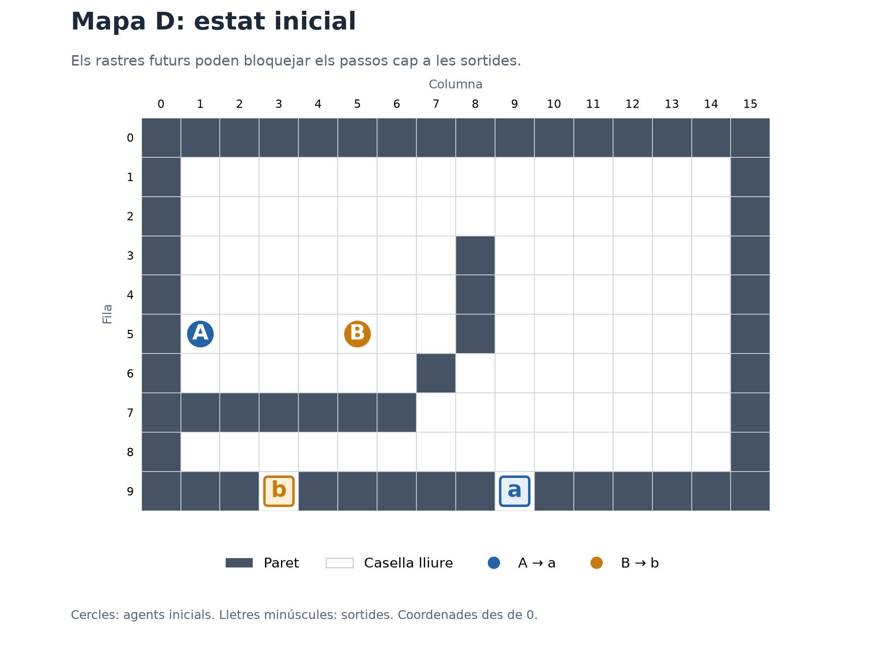
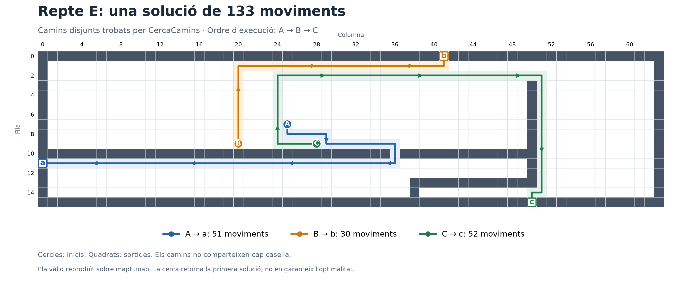

# Estudi de Multi-Snake

## Pla PDDL

Aquest és el pla que hem obtingut amb LAMA-first per al mapa A. Té **12 accions**.

```text
(moure agent-a p26 p25)
(moure agent-a p25 p24)
(moure agent-a p24 p23)
(moure agent-b p41 p42)
(moure agent-b p42 p43)
(moure agent-b p43 p44)
(moure agent-a p23 p22)
(moure agent-a p22 p21)
(sortir agent-a p21 p20)
(moure agent-b p44 p45)
(moure agent-b p45 p46)
(sortir agent-b p46 p47)
```

## Condicions de les proves

Hem fet les proves en un **Apple M4 Pro de 14 nuclis, amb 24 GiB de RAM i macOS 26.6.2**.

En totes les cerques hem utilitzat **`-Xmx2g` i un límit de 120 segons**, executant-les una darrere l’altra.

Cada combinació s’executa en un procés Java nou. Hem mantingut el mateix codi de cerca en les repeticions i hem fet servir els mapes del projecte base.

Per mesurar el temps, cridem `startTime()` abans de `ferCerca()` i `stopTime()` quan retorna o falla. Aquest temps inclou la reconstrucció del pla, però no la càrrega del mapa ni la validació final. El límit extern de 120 segons s’aplica al procés complet, inclosa l’arrencada de Java. Les taules recullen una execució de cada combinació; a [10] també mostrem les repeticions d’E i F.

A les taules, **M** vol dir que la cerca es queda sense memòria i **T**, que supera el límit de temps. El símbol **†** indica que només hem pogut recuperar l’última mostra abans del tall. En aquests casos escrivim `≥`, perquè els comptadors, els pics i el temps de cerca poden haver continuat augmentant. Com que el tall es fa als 120 segons de procés, el temps de cerca de la mostra pot ser inferior. La memòria es mesura en nodes.

En BFS sense LNT a C i E, i en A* bàsica sense LNT a E, hem pogut recollir `ResultatCerca` quan es produeix `OutOfMemoryError`. Per poder escriure aquests resultats després de l’error, reservem 64 KiB dins del mateix heap de 2 GiB. Aquestes tres files mostren els últims comptadors registrats i no porten `†`; les altres fallades amb dades parcials sí que el porten. En tots aquests casos la cerca falla sense trobar una solució.

Comptem com a nodes explorats els estats complets del joc. Les caselles que recorren les BFS auxiliars no compten com a estats nous. Els talls poden ser per repeticions, pel límit de profunditat o perquè una sortida és inabastable. El **pic total** és el màxim de `|LNO|+|LNT|` en un mateix instant, que pot ser diferent de la suma dels dos pics individuals. Són recomptes de nodes, no mesures dels bytes ocupats per les graelles, els pares o les estructures auxiliars.

## Respostes de l’estudi

### [1] Resum dels mapes i algorismes

Hem provat les 70 combinacions de les cerques estàndard amb els mapes i les dues opcions de LNT. Hem obtingut **27 plans vàlids**, **33 fallades per memòria** i **10 per temps**. També hem provat la cerca de camins disjunts als set mapes: els resol tots, amb **133 moviments a E** i **111 a F**. Això fa **77 combinacions diferents** i **34 plans vàlids**. Els nombres del resum indiquen la longitud del pla trobat.

| Cerca | LNT | A | B1 | B2 | C | D | E | F |
|---|---|---:|---:|---:|---:|---:|---:|---:|
| BFS | No | 12 | M | M | M | M | M | M |
| BFS | Sí | 12 | M | M | M | M | M | M |
| DFS | No | 12 | 19 | 31 | T | T | T | T |
| DFS | Sí | 12 | 19 | 31 | M | M | M | M |
| IDS | No | 12 | T | T | T | T | T | T |
| IDS | Sí | 12 | M | M | M | M | M | M |
| A* bàsica | No | 12 | 17 | 19 | 112 | M | M | M |
| A* bàsica | Sí | 12 | 17 | 19 | 112 | M | M | M |
| A* avançada | No | 12 | 17 | 19 | 112 | M | M | M |
| A* avançada | Sí | 12 | 17 | 19 | 112 | 42 | M | M |
| Camins disjunts (repte) | No | 12 | 17 | 25 | 112 | 42 | 133 | 111 |

L’enunciat dona els òptims d’A i D: 12 i 42 moviments. Amb les cerques que garanteixen l’òptim també hem obtingut B1=17, B2=19 i C=112. Per això marquem un pla de DFS o de camins disjunts com a òptim si coincideix amb aquests costos, encara que l’algorisme no ho garanteixi en general. A E no hem determinat si el pla és òptim; a F, el pla de contrast de [10] demostra que el de 111 no ho és.

#### Mètriques del mapa A

| Cerca | LNT | Resultat | Longitud | Òptima | Explorats | Tallats | Pic LNO | Pic LNT | Pic total | Temps cerca (ms) |
|---|---|---|---:|---|---:|---:|---:|---:|---:|---:|
| BFS | No | Sí | 12 | Sí | 697815 | 0 | 471259 | 0 | 471259 | 419 |
| BFS | Sí | Sí | 12 | Sí | 5893 | 5377 | 2355 | 5892 | 7257 | 23 |
| DFS | No | Sí | 12 | Sí | 13 | 0 | 23 | 0 | 23 | 5 |
| DFS | Sí | Sí | 12 | Sí | 13 | 0 | 23 | 12 | 35 | 5 |
| IDS | No | Sí | 12 | Sí | 993967 | 992008 | 31 | 0 | 31 | 423 |
| IDS | Sí | Sí | 12 | Sí | 15770 | 25063 | 29 | 5051 | 5051 | 35 |
| A* bàsica | No | Sí | 12 | Sí | 13 | 0 | 23 | 0 | 23 | 9 |
| A* bàsica | Sí | Sí | 12 | Sí | 13 | 0 | 23 | 12 | 35 | 8 |
| A* avançada | No | Sí | 12 | Sí | 13 | 3 | 20 | 0 | 20 | 8 |
| A* avançada | Sí | Sí | 12 | Sí | 13 | 3 | 20 | 12 | 32 | 8 |
| Camins disjunts (repte) | No | Sí | 12 | Sí | 13 | 0 | 11 | 0 | 11 | 10 |

#### Mètriques del mapa B1

| Cerca | LNT | Resultat | Longitud | Òptima | Explorats | Tallats | Pic LNO | Pic LNT | Pic total | Temps cerca (ms) |
|---|---|---|---:|---|---:|---:|---:|---:|---:|---:|
| BFS | No | No (M) † | — | — | ≥ 877665 | ≥ 0 | ≥ 2631677 | ≥ 0 | ≥ 2631677 | ≥ 2088 |
| BFS | Sí | No (M) † | — | — | ≥ 1227030 | ≥ 1171055 | ≥ 2166720 | ≥ 1227029 | ≥ 3393749 | ≥ 5294 |
| DFS | No | Sí | 19 | No | 129 | 0 | 67 | 0 | 67 | 7 |
| DFS | Sí | Sí | 19 | No | 129 | 0 | 67 | 128 | 189 | 9 |
| IDS | No | No (T) † | — | — | ≥ 145484737 | ≥ 377043190 | ≥ 66 | ≥ 0 | ≥ 66 | ≥ 119008 |
| IDS | Sí | No (M) † | — | — | ≥ 8739247 | ≥ 22897607 | ≥ 80 | ≥ 3507153 | ≥ 3507173 | ≥ 36058 |
| A* bàsica | No | Sí | 17 | Sí | 28 | 0 | 66 | 0 | 66 | 8 |
| A* bàsica | Sí | Sí | 17 | Sí | 28 | 0 | 66 | 27 | 93 | 8 |
| A* avançada | No | Sí | 17 | Sí | 18 | 4 | 56 | 0 | 56 | 10 |
| A* avançada | Sí | Sí | 17 | Sí | 18 | 4 | 56 | 17 | 73 | 9 |
| Camins disjunts (repte) | No | Sí | 17 | Sí | 18 | 0 | 32 | 0 | 32 | 8 |

#### Mètriques del mapa B2

| Cerca | LNT | Resultat | Longitud | Òptima | Explorats | Tallats | Pic LNO | Pic LNT | Pic total | Temps cerca (ms) |
|---|---|---|---:|---|---:|---:|---:|---:|---:|---:|
| BFS | No | No (M) † | — | — | ≥ 839237 | ≥ 0 | ≥ 2670271 | ≥ 0 | ≥ 2670271 | ≥ 2140 |
| BFS | Sí | No (M) † | — | — | ≥ 1162285 | ≥ 1075522 | ≥ 2236323 | ≥ 1162284 | ≥ 3398607 | ≥ 6060 |
| DFS | No | Sí | 31 | No | 24930927 | 0 | 95 | 0 | 95 | 7387 |
| DFS | Sí | Sí | 31 | No | 8050 | 7115 | 95 | 8049 | 8126 | 28 |
| IDS | No | No (T) † | — | — | ≥ 110738981 | ≥ 315726894 | ≥ 58 | ≥ 0 | ≥ 58 | ≥ 119008 |
| IDS | Sí | No (M) † | — | — | ≥ 8432549 | ≥ 22911991 | ≥ 71 | ≥ 3494955 | ≥ 3494975 | ≥ 41111 |
| A* bàsica | No | Sí | 19 | Sí | 648328 | 0 | 1061058 | 0 | 1061058 | 797 |
| A* bàsica | Sí | Sí | 19 | Sí | 4767 | 4012 | 9090 | 4766 | 13856 | 35 |
| A* avançada | No | Sí | 19 | Sí | 1453 | 962 | 5316 | 0 | 5316 | 46 |
| A* avançada | Sí | Sí | 19 | Sí | 227 | 256 | 765 | 226 | 991 | 22 |
| Camins disjunts (repte) | No | Sí | 25 | No | 120 | 29 | 23 | 0 | 23 | 11 |

#### Mètriques del mapa C

| Cerca | LNT | Resultat | Longitud | Òptima | Explorats | Tallats | Pic LNO | Pic LNT | Pic total | Temps cerca (ms) |
|---|---|---|---:|---|---:|---:|---:|---:|---:|---:|
| BFS | No | No (M) | — | — | 27425 | 0 | 224884 | 0 | 224884 | 1283 |
| BFS | Sí | No (M) † | — | — | ≥ 31872 | ≥ 39231 | ≥ 219802 | ≥ 31871 | ≥ 251673 | ≥ 1146 |
| DFS | No | No (T) † | — | — | ≥ 18545443 | ≥ 136635835 | ≥ 500 | ≥ 0 | ≥ 500 | ≥ 119018 |
| DFS | Sí | No (M) † | — | — | ≥ 252024 | ≥ 1953007 | ≥ 500 | ≥ 252023 | ≥ 252496 | ≥ 10047 |
| IDS | No | No (T) † | — | — | ≥ 21203047 | ≥ 157702686 | ≥ 82 | ≥ 0 | ≥ 82 | ≥ 119018 |
| IDS | Sí | No (M) † | — | — | ≥ 486124 | ≥ 3811059 | ≥ 82 | ≥ 252651 | ≥ 252664 | ≥ 13096 |
| A* bàsica | No | Sí | 112 | Sí | 113 | 0 | 547 | 0 | 547 | 12 |
| A* bàsica | Sí | Sí | 112 | Sí | 113 | 0 | 547 | 112 | 659 | 14 |
| A* avançada | No | Sí | 112 | Sí | 113 | 6 | 541 | 0 | 541 | 115 |
| A* avançada | Sí | Sí | 112 | Sí | 113 | 6 | 541 | 112 | 653 | 105 |
| Camins disjunts (repte) | No | Sí | 112 | Sí | 113 | 0 | 167 | 0 | 167 | 59 |

#### Mètriques del mapa D

| Cerca | LNT | Resultat | Longitud | Òptima | Explorats | Tallats | Pic LNO | Pic LNT | Pic total | Temps cerca (ms) |
|---|---|---|---:|---|---:|---:|---:|---:|---:|---:|
| BFS | No | No (M) † | — | — | ≥ 479738 | ≥ 0 | ≥ 1591293 | ≥ 0 | ≥ 1591293 | ≥ 1036 |
| BFS | Sí | No (M) † | — | — | ≥ 636685 | ≥ 569179 | ≥ 1411466 | ≥ 636684 | ≥ 2048150 | ≥ 3016 |
| DFS | No | No (T) † | — | — | ≥ 109693154 | ≥ 222725745 | ≥ 172 | ≥ 0 | ≥ 172 | ≥ 119009 |
| DFS | Sí | No (M) † | — | — | ≥ 2082148 | ≥ 4433018 | ≥ 174 | ≥ 2082147 | ≥ 2082306 | ≥ 24131 |
| IDS | No | No (T) † | — | — | ≥ 109416735 | ≥ 330300738 | ≥ 55 | ≥ 0 | ≥ 55 | ≥ 119009 |
| IDS | Sí | No (M) † | — | — | ≥ 4645950 | ≥ 13992958 | ≥ 64 | ≥ 2094157 | ≥ 2094186 | ≥ 20114 |
| A* bàsica | No | No (M) † | — | — | ≥ 741136 | ≥ 0 | ≥ 1334957 | ≥ 0 | ≥ 1334957 | ≥ 2141 |
| A* bàsica | Sí | No (M) † | — | — | ≥ 685575 | ≥ 495781 | ≥ 1343533 | ≥ 685574 | ≥ 2029107 | ≥ 4036 |
| A* avançada | No | No (M) † | — | — | ≥ 775386 | ≥ 818391 | ≥ 1295905 | ≥ 0 | ≥ 1295905 | ≥ 34110 |
| A* avançada | Sí | Sí | 42 | Sí | 50011 | 99974 | 72482 | 50010 | 122492 | 868 |
| Camins disjunts (repte) | No | Sí | 42 | Sí | 47 | 4 | 45 | 0 | 45 | 12 |

#### Mètriques del mapa E

| Cerca | LNT | Resultat | Longitud | Òptima | Explorats | Tallats | Pic LNO | Pic LNT | Pic total | Temps cerca (ms) |
|---|---|---|---:|---|---:|---:|---:|---:|---:|---:|
| BFS | No | No (M) | — | — | 57831 | 0 | 407117 | 0 | 407117 | 1156 |
| BFS | Sí | No (M) † | — | — | ≥ 68943 | ≥ 92116 | ≥ 392888 | ≥ 68943 | ≥ 461831 | ≥ 1010 |
| DFS | No | No (T) † | — | — | ≥ 21352111 | ≥ 144440393 | ≥ 406 | ≥ 0 | ≥ 406 | ≥ 119009 |
| DFS | Sí | No (M) † | — | — | ≥ 465226 | ≥ 3258121 | ≥ 407 | ≥ 465225 | ≥ 465577 | ≥ 8014 |
| IDS | No | No (T) † | — | — | ≥ 31732636 | ≥ 214574478 | ≥ 71 | ≥ 0 | ≥ 71 | ≥ 119009 |
| IDS | Sí | No (M) † | — | — | ≥ 808574 | ≥ 5576961 | ≥ 80 | ≥ 465953 | ≥ 465994 | ≥ 10048 |
| A* bàsica | No | No (M) | — | — | 149168 | 0 | 315149 | 0 | 315149 | 1296 |
| A* bàsica | Sí | No (M) † | — | — | ≥ 116925 | ≥ 113625 | ≥ 340551 | ≥ 116924 | ≥ 457475 | ≥ 1010 |
| A* avançada | No | No (M) † | — | — | ≥ 138882 | ≥ 292026 | ≥ 325484 | ≥ 0 | ≥ 325484 | ≥ 63036 |
| A* avançada | Sí | No (M) † | — | — | ≥ 123432 | ≥ 284256 | ≥ 339504 | ≥ 123431 | ≥ 462935 | ≥ 58154 |
| Camins disjunts (repte) | No | Sí | 133 | No determinada | 134 | 0 | 158 | 0 | 158 | 36 |

#### Mètriques del mapa F

| Cerca | LNT | Resultat | Longitud | Òptima | Explorats | Tallats | Pic LNO | Pic LNT | Pic total | Temps cerca (ms) |
|---|---|---|---:|---|---:|---:|---:|---:|---:|---:|
| BFS | No | No (M) † | — | — | ≥ 143098 | ≥ 0 | ≥ 905925 | ≥ 0 | ≥ 905925 | ≥ 1067 |
| BFS | Sí | No (M) † | — | — | ≥ 180728 | ≥ 271567 | ≥ 863876 | ≥ 180727 | ≥ 1044603 | ≥ 2156 |
| DFS | No | No (T) † | — | — | ≥ 52865330 | ≥ 221949575 | ≥ 427 | ≥ 0 | ≥ 427 | ≥ 119005 |
| DFS | Sí | No (M) † | — | — | ≥ 1053785 | ≥ 4456863 | ≥ 427 | ≥ 1053784 | ≥ 1054162 | ≥ 9027 |
| IDS | No | No (T) † | — | — | ≥ 51732327 | ≥ 294658556 | ≥ 92 | ≥ 0 | ≥ 92 | ≥ 119010 |
| IDS | Sí | No (M) † | — | — | ≥ 1935077 | ≥ 11939790 | ≥ 102 | ≥ 1054192 | ≥ 1054228 | ≥ 15029 |
| A* bàsica | No | No (M) † | — | — | ≥ 292876 | ≥ 0 | ≥ 751555 | ≥ 0 | ≥ 751555 | ≥ 1095 |
| A* bàsica | Sí | No (M) † | — | — | ≥ 244588 | ≥ 240498 | ≥ 738568 | ≥ 244587 | ≥ 983155 | ≥ 2050 |
| A* avançada | No | No (M) † | — | — | ≥ 210892 | ≥ 230565 | ≥ 833864 | ≥ 0 | ≥ 833864 | ≥ 66082 |
| A* avançada | Sí | No (M) † | — | — | ≥ 207836 | ≥ 470230 | ≥ 829792 | ≥ 207835 | ≥ 1037627 | ≥ 68028 |
| Camins disjunts (repte) | No | Sí | 111 | No | 1847083 | 547844 | 103 | 0 | 103 | 47633 |

Els errors de temps o memòria indiquen que no s’ha trobat una solució dins dels recursos permesos; no demostren que el mapa sigui irresoluble. En IDS, les exploracions i els talls acumulen totes les iteracions, mentre que els pics de memòria són màxims, no sumes.

### [2] Té sentit buscar cicles dins de la branca?

En aquest joc no podem tornar al mateix estat dins d’una branca. Cada moviment deixa una paret nova i el nombre de parets augmenta. Com que `equals()` compara tota la graella, l’estat següent ja és diferent dels anteriors. Tampoc podem tornar a una casella que hem abandonat, perquè el rastre ho impedeix.

Per tant, el control d’ancestres no elimina cap cicle en aquest problema, però l’hem mantingut a les cerques estàndard perquè el demana l’enunciat. A A, BFS sense LNT fa **0 talls**. Amb LNT en fa **5.377**, perquè un mateix estat sí que pot aparèixer en branques diferents, sobretot quan intercalem de maneres diferents els moviments dels agents.

Els talls d’IDS sense LNT no contradiuen aquesta propietat: inclouen els successors descartats pel límit de profunditat de cada iteració. Els d’A* avançada també inclouen la poda de sortides inabastables.

### [3] Factor d’embrancament real de BFS a A i avantatges de LNT

Hem calculat la mitjana dividint els successors legals generats, `G`, pels nodes que s’han expandit. Si `E` és el nombre de nodes explorats, fem **G/(E−1)**: restem la meta perquè es comprova, però no se’n generen successors.

| LNT | Explorats (E) | Generats (G) | G/(E−1) | Pic total |
|---|---:|---:|---:|---:|
| No | 697815 | 1168963 | 1.675178 | 471259 |
| Sí | 5893 | 12607 | 2.139681 | 7257 |

Amb LNT es processen menys repeticions i, per tant, la mitjana es calcula sobre un conjunt d’expansions diferent. Que la mitjana sigui més alta no vol dir que la cerca sigui pitjor: cal mirar quants nodes s’exploren en total i quanta memòria es necessita.

Amb LNT s’exploren **5.893** nodes, en lloc de **697.815**: aproximadament **118,4 vegades menys**. El pic total baixa de **471.259** a **7.257** nodes, unes **64,9 vegades menys**, malgrat emmagatzemar també els tancats. La LNT costa memòria per entrada i consultes de hash, però evita tornar a expandir molts estats equivalents i redueix molt més la frontera en aquest mapa.

### [4] Diferències entre B1 i B2

Tots dos mapes tenen 7×10 caselles, 42 transitables, dos agents i les mateixes parets i sortides. Només canvia l’inici d’A: de `(3,6)` a B1 passa a `(1,6)` a B2, amb coordenades des de zero. B continua a `(2,2)`; les sortides són `a=(4,0)` i `b=(5,9)`. La distància Manhattan d’A augmenta de 7 a 9, mentre que la de B es manté en 10. La suma inicial passa de **17 a 19**, que en aquests dos mapes coincideix amb l’òptim trobat per A*.

A* estableix un òptim de **17 moviments en B1** i **19 en B2**. DFS retorna **19** i **31**, respectivament: són plans vàlids, però subòptims. En B2, DFS passa de **24.930.927** exploracions sense LNT a **8.050** amb LNT. Això mostra la quantitat de branques equivalents que pot recórrer abans de trobar el primer pla.

BFS esgota el heap als dos mapes, amb i sense LNT. IDS sense LNT arriba al límit de temps i amb LNT esgota memòria. A* bàsica sense LNT explora **28** nodes a B1 i **648.328** a B2; l’avançada amb LNT en necessita **18** i **227**. No hi ha nous obstacles fixos a B2: la diferència prové de la posició inicial d’A, dels rastres que es poden formar i de l’ordre en què les cerques proven les alternatives. Manhattan tampoc detecta que un rastre ha desconnectat una sortida. L’avançada amb LNT registra **4 talls a B1** i **256 a B2**, entre repeticions i inabastables. Per tant, dos moviments més de cost òptim poden anar acompanyats de moltes més branques explorades; la dificultat no depèn només de la mida del mapa o de la longitud de la solució.

### [5] Admissibilitat, consistència i A* amb LNT

Siguin `g(s)` el cost ja recorregut i `h*(s)` el cost mínim restant. Una heurística és admissible si `h(s) ≤ h*(s)` i consistent si, per qualsevol moviment de cost 1, `h(s) ≤ 1+h(s')`, amb valor zero a la meta.

**Bàsica.** Cada agent necessita almenys la seva distància Manhattan per arribar a la sortida, i un torn només mou un agent una casella. La suma és una cota inferior, encara que hi hagi obstacles o interferències: és admissible. Un moviment només pot reduir en una unitat la distància Manhattan de l’agent que es mou; la resta de termes no canvien. Quan surt, la contribució passa d’1 a 0. Per tant, és consistent.

**Avançada.** La BFS individual troba una distància mínima al tauler actual. Qualsevol solució global haurà de donar a cada agent un camí d’almenys aquella longitud; altres moviments només poden afegir obstacles. La suma és admissible, encara que els camins individuals mínims siguin incompatibles entre si. Si una sortida és inabastable ara, els moviments futurs no poden obrir un pas: la poda és segura.

Per a la consistència, considerem l’agent que es mou de `p` a `q`: qualsevol camí restant des de `q` es pot precedir amb el pas `p→q`, de manera que la seva distància anterior és com a màxim 1 més la nova. Per als altres agents, la casella `p` ja estava bloquejada per l’agent i passa a ser paret; `q` passa de lliure a bloquejada. No guanyen cap casella i les seves distàncies no disminueixen. Si l’agent surt, la seva distància anterior era 1 i la nova contribució és 0. Sumant, s’obté la desigualtat de consistència. Els estats `INF` no poden recuperar una solució.

Amb una heurística consistent, A* pot tancar un estat quan l’extreu amb cost mínim i no necessita reobrir-lo per conservar l’òptim. La implementació igualment admet un `g` menor com a protecció general per a altres heurístiques admissibles que fossin inconsistents. La garantia depèn d’extreure la meta de la cua, i no d’acabar quan es genera per primer cop.

També hem comprovat les heurístiques en tots els estats assolibles de tres mapes petits: **299 estats i 519 transicions**. Hem calculat el cost restant exacte explorant totes les continuacions. En aquests casos es compleixen l’admissibilitat, la consistència i el valor zero a la meta, i l’avançada sempre és igual o superior a la bàsica. Els **230 estats sense solució** també ens han servit per comprovar que la poda amb `INF` és segura. La demostració general es basa en les distàncies i en el fet que els obstacles només poden augmentar.

### [6] Quina heurística dona millors resultats?

L’avançada domina la bàsica com a estimació: una distància que respecta obstacles no pot ser menor que Manhattan. A més, detecta estats impossibles que la bàsica continua explorant. A B1, A* passa de **28** exploracions amb la bàsica a **18** amb l’avançada. A B2 sense LNT passa de **648.328** a **1.453**; amb LNT, de **4.767** a **227**.

A A, totes dues exploren 13 nodes pel desempat que afavoreix menor `h`. L’avançada talla tres successors i baixa el pic total de 23 a 20 sense LNT, i de 35 a 32 amb LNT. Ara bé, calcular-la costa més: necessita una BFS per agent i estat, mentre que Manhattan es calcula amb unes poques operacions. Això fa que no sempre sigui la més ràpida, tal com es veu al mapa C.

### [7] Influència de les heurístiques al mapa C

C té 25×78 caselles, 1.751 transitables i tres agents. Les quatre variants d’A* troben plans vàlids i òptims de **112 moviments** explorant **113 nodes**. Amb el desempat per menor `h`, totes dues heurístiques segueixen una branca de cost òptim; no cal esperar necessàriament un gran avantatge de l’avançada en aquest mapa.

La bàsica triga **12 ms sense LNT** i **14 ms amb LNT**; l’avançada, **115 ms** i **105 ms**. L’avançada talla sis successors i redueix modestament els pics totals (547→541 sense LNT; 659→653 amb LNT), però el cost de les BFS individuals sobre una graella gran domina el temps. Això és un exemple mesurat de més informació heurística sense menys expansions, i amb més cost per node.

BFS es queda sense memòria amb les dues opcions de LNT. DFS i IDS sense LNT arriben als 120 segons, i amb LNT esgoten el heap. A més, DFS té el límit de 50, de manera que no pot arribar a una solució de 112 moviments. Amb les cerques estàndard i els límits de les proves, només A* resol C, tal com indica l’enunciat.

### [8] Influència de les heurístiques al mapa D



D té 10×16 caselles, 104 transitables i dos agents. Entre les cerques estàndard, només **A* avançada amb LNT** acaba sota els límits de la bateria: troba un pla validat de **42 moviments**, que coincideix amb l’òptim de referència de l’enunciat. Explora **50.011** nodes, talla **99.974** i arriba a un pic total de **122.492** nodes en **868 ms** de cerca.

A* bàsica esgota el heap amb i sense LNT: les darreres mostres ja registren almenys **741.136** i **685.575** exploracions. A* avançada sense LNT també esgota memòria, després d’almenys **775.386** exploracions i **818.391** talls observats. Aquesta darrera xifra d’exploracions és més de 15 vegades les **50.011** del cas resolt. Els obstacles fan que Manhattan sigui poc informativa i que la poda d’inabastables sigui especialment útil; alhora, les repeticions entre branques fan necessària la LNT en aquesta execució.

BFS falla per memòria en totes dues variants; DFS i IDS sense LNT fallen per temps i amb LNT per memòria. Dins d’aquestes cerques estàndard, la combinació que resol D és la heurística avançada amb LNT. L’alternativa específica de camins disjunts també retorna 42 moviments, amb **47 exploracions**, **4 talls** i pic LNO de **45 nodes**: aprofita la restricció d’ordre entre agents de [11] per explorar menys intercalacions. Aquest resultat correspon al mètode del repte de [10], que canvia l’organització de la cerca.

### [9] Per què els algorismes estàndard fallen a E/F?

E té 16×64 caselles, 799 transitables i tres agents; F té 14×28, 272 transitables i també tres agents. Els colls d’ampolla i la compatibilitat dels camins fan que F pugui ser difícil tot i ser més petit. Les sumes de distàncies individuals BFS inicials són **125** per a E i **85** per a F: són cotes inferiors, no plans conjunts.

Per això DFS limitada a 50 no pot retornar cap solució d’aquests mapes, independentment del temps que dediqui a explorar fins al seu límit. IDS ha de repetir les cerques poc profundes abans d’arribar, com a mínim, a aquestes profunditats. BFS acumula una frontera molt gran; cada estat conserva una còpia de la graella i les referències als pares. A* redueix exploracions amb les heurístiques, però una cota individual no captura tota la incompatibilitat entre els camins ni elimina totes les intercalacions d’agents.

En les 20 combinacions estàndard d’E/F, cap cerca retorna un pla: **16 fallen per memòria i 4 per temps**. El mètode específic del repte, descrit a [10], sí que els resol. Alguns valors observats representatius de les cerques estàndard són:

| Mapa | Cerca | LNT | Resultat | Explorats observats | Profunditat registrada | Pic total observat | Procés s |
|---|---|---|---|---:|---:|---:|---:|
| mapE | bfs | Sí | MEMORIA | ≥ 68943 | ≥ 7 | ≥ 461831 | 2.012 |
| mapE | ids | No | TEMPS | ≥ 31732636 | ≥ 8 | ≥ 71 | 120.011 |
| mapE | astar-avancada | Sí | MEMORIA | ≥ 123432 | ≥ 49 | ≥ 462935 | 58.735 |
| mapF | bfs | Sí | MEMORIA | ≥ 180728 | ≥ 8 | ≥ 1044603 | 2.628 |
| mapF | ids | No | TEMPS | ≥ 51732327 | ≥ 9 | ≥ 92 | 120.01 |
| mapF | astar-avancada | Sí | MEMORIA | ≥ 207836 | ≥ 27 | ≥ 1037627 | 69.057 |

A* avançada amb LNT esgota el heap després d’uns **59 segons a E** i **69 a F**. Per tant, reforçar l’heurística no elimina prou estats en aquests mapes. IDS sense LNT consumeix els 120 segons i la darrera mostra només registra profunditats 8 i 9, molt per sota de les cotes inicials 125 i 85.

Cada còpia de la graella ocupa com a mínim `4·n·m` bytes pels enters. Encara hi hem d’afegir les capçaleres dels arrays, els agents, els nodes, els pares i les taules hash. Amb els pics observats de BFS amb LNT, només els enters de les graelles ja ocuparien aproximadament **1,76 GiB a E** i **1,53 GiB a F**, comptant una graella per estat de LNO/LNT. Amb la resta d’objectes i els estats conservats pels pares, s’entén que s’esgotin els 2 GiB. És una estimació a partir del nombre de nodes, no una mesura directa del heap.


Les dades de fallada són les darreres mostres observades, no el nombre d’estats necessari per resoldre’ls. Tampoc demostren que els mapes siguin irresolubles; demostren que aquestes implementacions no els han resolt sota els recursos fixats.

### [10] Un altre enfocament per a E i F

Hem implementat **`CercaCamins`**, que resol tant **E com F**. Combina backtracking amb distàncies BFS i busca **camins complets disjunts per agent**, sense generar les intercalacions equivalents dels seus moviments.



1. Escollim el primer agent que encara no ha sortit, en ordre A, B, C, etc., i no canviem d’agent fins que arriba a la seva sortida.
2. Per cada agent pendent, una BFS inversa des de la seva sortida calcula les distàncies al tauler actual. Reserva les posicions i les sortides dels altres agents: cap solució completa pot compartir aquestes caselles.
3. Si alguna sortida és inabastable, tallem la branca. Els rastres futurs només poden afegir obstacles; no poden recuperar-ne l’accés.
4. Ordenem els moviments legals de l’agent escollit per la distància BFS de la casella de destí a la seva sortida, calculada sobre el mapa del pare. Els apilem en ordre invers a la LNO perquè el més proper surti primer. En cas d’empat es conserva l’ordre del model: amunt, avall, esquerra i dreta. Cada fill té una còpia del mapa amb el rastre del pas aplicat; en explorar-lo es recalculen les distàncies.
5. Si una branca falla, la pila recupera alternatives anteriors: també es proven camins més llargs, no només un camí mínim per agent. Retornem la primera solució completa.

La cerca principal és una **DFS guiada per distàncies BFS**, amb backtracking i poda d’inabastables. Ordenem els fills del node actual, no tota la frontera, i no fem cap tall per `f=g+h`. Les BFS dels altres agents només comproven que encara puguin sortir. Les intercalacions que evitem no arriben a generar-se i, per això, no compten com a nodes tallats.

**Completesa.** Si hi ha una solució, els seus camins són disjunts i es poden executar en ordre A, B, C, com justifiquem a [11]. Guardem totes les alternatives legals d’aquest ordre, també els rodejos. Si fallen les continuacions de B o C, podem tornar a provar un altre camí d’A. Les podes no eliminen una solució possible: cap agent pot compartir el camí amb la posició o la sortida d’un altre, i afegir rastres no pot recuperar una sortida inabastable. Com que cada moviment crea una paret nova, la profunditat i el nombre de branques són finits. Amb prou recursos, la DFS trobarà una solució o acabarà d’explorar l’arbre si no n’hi ha. Aquesta cerca no utilitza LNT ni el límit de 50 de la DFS estàndard.

**Optimalitat.** No la garantim, perquè retornar el primer pla trobat no assegura que la suma dels camins sigui mínima. A B2 es veu clarament: `CercaCamins` fa **25 moviments** i A* en fa **19**. A A, B1, C i D sí que coincidim amb l’òptim conegut, però això no es pot generalitzar. Una possible millora seria continuar després de trobar una solució i aplicar Branch and Bound amb una cota inferior admissible. Aquesta millora no forma part del codi actual.

**Resultat a E.** Obtenim un pla vàlid de **133 moviments** (A: 51, B: 30 i C: 52) en **36 ms**. La cerca explora **134 estats**, amb **0 talls**, pic LNO de **158 nodes** i LNT de **0**. Hem aplicat les mateixes condicions de les altres proves i hem comprovat el pla amb el validador del projecte. La cota inferior inicial és 125; no hem demostrat si el pla de 133 és òptim.

Els 134 estats són l’inicial més els 133 passos del pla. A E trobem una solució sense haver d’explorar cap branca fallida. Generem **290 successors**, però moltes alternatives encara són a la pila quan arribem a la meta. Per això el temps és tan curt: no arribem a explorar tots els plans possibles, tot i que les BFS auxiliars sí que recorren caselles per decidir els passos.

Per comprovar aquest temps tan curt, hem repetit la cerca en cinc processos Java nous amb `-Xmx2g`. També hem mesurat `ferCerca()` amb `System.nanoTime()`. En totes les repeticions obtenim un pla vàlid de 133 moviments, amb 134 exploracions i pic LNO de 158 nodes:

| Repetició E | `ResultatCerca` (ms) | `System.nanoTime()` (ms) | Procés complet (ms) |
|---|---:|---:|---:|
| 1 | 30 | 29,198 | 68,611 |
| 2 | 29 | 28,413 | 64,580 |
| 3 | 28 | 28,630 | 64,597 |
| 4 | 29 | 28,854 | 68,388 |
| 5 | 30 | 29,638 | 67,326 |

El temps del procés complet inclou l’arrencada, la càrrega, la cerca i la validació. També hem comprovat que el heap màxim és de **2.147.483.648 bytes**, és a dir, 2 GiB. Amb el segon cronòmetre mesurem la cerca sense el monitor de progrés; els 36 ms de la taula principal també inclouen la preparació del monitor i la primera sortida de progrés. Les repeticions confirmen que E es resol en desenes de mil·lisegons.

**Resultats d’execució a F.** Hem executat `CercaCamins` dues vegades sobre `mapF.map`, sense LNT, amb `-Xmx2g` i el límit de 120 segons. En totes dues execucions hem obtingut un pla de **111 moviments**, comprovat amb el validador del projecte. A fa 38 moviments, B en fa 16 i C en fa 57.

| Dada | Primera execució | Repetició |
|---|---:|---:|
| Solució trobada i validada | Sí | Sí |
| Longitud del pla (moviments) | 111 | 111 |
| Solució òptima | No | No |
| Nodes explorats | 1847083 | 1847083 |
| Nodes tallats | 547844 | 547844 |
| Pic LNO (nodes) | 103 | 103 |
| Pic LNT (nodes) | 0 | 0 |
| Pic total (nodes) | 103 | 103 |
| Temps de cerca (ms) | 47633 | 46322 |
| Temps de cerca (s) | 47,633 | 46,322 |

Per tant, F es resol en uns **46–48 segons** en aquestes proves. Les dues execucions mantenen els mateixos comptadors i acaben abans del límit. A les taules generals fem servir els **47633 ms** de la primera execució. En la repetició també hem registrat el temps del procés complet: **46,367 segons**, incloent l’arrencada, la càrrega del mapa i la validació final.

A F hem de provar moltes alternatives, però la frontera es manté petita: els 103 nodes són el pic de LNO, no el total d’estats que s’han explorat. Sabem que el pla de 111 no és òptim perquè també hem validat un pla de **97 moviments**. Aquest altre pla serveix de contrast; no correspon a una altra cerca Java integrada al projecte i tampoc hem demostrat que 97 sigui l’òptim.

Per reproduir el pla de contrast des de l’estat inicial de F, s’executen aquestes seqüències en ordre A, B, C. Les fletxes indiquen la direcció i el nombre, quantes vegades es repeteix el moviment:

| Agent | Moviments | Seqüència del pla de contrast |
|---|---:|---|
| A | 34 | ↑2 →4 ↑4 ←12 ↓10 ←2 |
| B | 16 | ↑1 →3 ↑5 →6 ↑1 |
| C | 47 | ↑1 ←1 ↑1 ←1 ↑1 ←1 ↑2 ←1 ↑4 →2 ↓1 →2 ↓5 →6 ↑1 →6 ↓5 →5 ↓1 |

Les taules d’E i F recullen les mètriques del repte. El pic de memòria compta els nodes de la frontera de cerca; no és una mesura en bytes de les graelles, les cadenes de pares ni les matrius auxiliars BFS.

### [11] Ordre dels agents i intercalacions equivalents

En una solució completa, dos agents diferents no poden utilitzar la mateixa casella: mentre un l’ocupa, bloqueja l’altre; quan l’abandona o surt, es converteix en paret. Cada agent també descriu un camí simple perquè no pot tornar sobre el seu rastre.

Un cop fixats els camins d’una solució, podem intercalar els moviments com vulguem mentre respectem l’ordre dels passos de cada agent. Com que no comparteixen caselles, no es bloquegen entre ells i el cost sempre és la suma de les longituds. Aquesta propietat es refereix a camins que ja formen una solució; si en triem d’altres, sí que podem bloquejar un agent.

Amb `k` agents i `N` moviments cadascun, les intercalacions són:

$$
\frac{(kN)!}{(N!)^k}.
$$

Es poden comptar triant primer les `N` posicions dels moviments d’A entre els `kN` torns, després les `N` de B entre els torns restants, i així successivament. El producte d’aquestes eleccions dona la fórmula, perquè l’ordre intern dels moviments de cada agent queda fixat pel seu camí.

Per dos agents és `binomial(2N,N)`; per tres, `(3N)!/(N!)³`. Amb longituds diferents `l₁,…,lₖ`, el nombre és `(Σlᵢ)! / ∏lᵢ!`. Per reduir la cerca podem executar els camins complets en un ordre canònic d’agents i usar backtracking sobre les alternatives de camins. La LNT ja elimina algunes arribades equivalents, però planificar camins evita generar moltes d’aquestes intercalacions.

En el pla d’A, cada agent fa sis passos: `12!/(6!·6!) = 924`. Hem provat les **924 intercalacions** d’aquests dos camins amb el model del projecte. Totes són legals, fan 12 moviments i deixen el mateix estat final. Si completem primer A i després B, ens quedem amb una d’aquestes seqüències equivalents.

### [12] Garanties d’optimalitat amb i sense LNT

| Algorisme | Sense LNT | Amb LNT |
|---|---|---|
| BFS | Òptim amb costos unitaris | Òptim amb costos unitaris |
| DFS limitada a 50 | No garanteix l’òptim | No garanteix l’òptim |
| IDS | Òptim amb costos unitaris | Òptim amb la LNT reiniciada i el control de profunditats implementat |
| A* bàsica | Òptim amb l’heurística admissible | Òptim amb l’heurística admissible i el tractament correcte de LNT |
| A* avançada | Òptim amb l’heurística admissible i la poda segura d’inabastables | Òptim amb les mateixes condicions i el tractament correcte de LNT |
| Camins disjunts (repte E/F) | No garanteix l’òptim | No s’utilitza LNT |

BFS explora per profunditat; IDS augmenta el límit fins a la primera profunditat amb solució. Amb costos unitaris això dona una solució mínima. A* extreu primer la menor cota `g+h`; les heurístiques són admissibles i consistents, com s’ha justificat a [5], i la implementació admet reobertures si apareix un cost menor. Sense LNT, només es descarten repeticions dins de la branca, que no són necessàries per a un camí òptim.

DFS no selecciona el camí de menor cost i el límit 50 pot excloure solucions. Que al mapa A trobi l’òptim no implica una garantia general. Totes les garanties anteriors pressuposen que la cerca acaba amb recursos suficients: arribar al límit experimental de temps o memòria impedeix obtenir el resultat.

### [13] Memòria i temps de BFS respecte d’IDS


Al mapa A tots dos acaben amb i sense LNT i retornen 12 moviments. Sense LNT, BFS explora **697.815** nodes i IDS **993.967**; el pic de nodes oberts és **471.259** per BFS i **31** per IDS. IDS repeteix treball de les profunditats anteriors a canvi de conservar una frontera de profunditat molt més petita.

Amb LNT, BFS explora **5.893** nodes i IDS **15.770**; els pics totals són **7.257** i **5.051**, respectivament. IDS reinicia la LNT en cada iteració i, per això, continua repetint expansions. Amb LNT ja no podem atribuir-li la memòria lineal pròpia de la DFS d’arbre: els estats tancats d’una iteració poden ocupar molta memòria.

Sense LNT, BFS tarda **419 ms** i IDS **423 ms**; amb LNT, **23 ms** i **35 ms**, respectivament. Els recomptes encaixen amb la teoria: BFS evita repetir nivells, mentre que IDS explora més nodes i conserva una frontera més petita. Si alguna cerca no acaba, no podem comparar els temps com si totes dues haguessin resolt el mapa. A més, només tenim una mesura de cada combinació de BFS i IDS, de manera que una diferència de pocs mil·lisegons no és suficient per dir que una sempre serà més ràpida.

En el model teòric d’un arbre amb factor d’embrancament màxim `b>1`, solució a profunditat `d` i cost constant per node, tant BFS com IDS tenen cost temporal `O(b^d)`: en IDS, repetir els nivells anteriors afegeix un factor constant en aquest model. La diferència principal és espacial: BFS conserva `O(b^d)` nodes de frontera, mentre que IDS sense LNT conserva `O(b·d)` nodes, com una DFS que guarda les alternatives de la branca actual. Les dades d’A reflecteixen aquest intercanvi entre repetició de treball i memòria. Aquest avantatge espacial deixa de ser una garantia quan IDS manté una LNT que pot créixer amb el nombre d’estats explorats.
